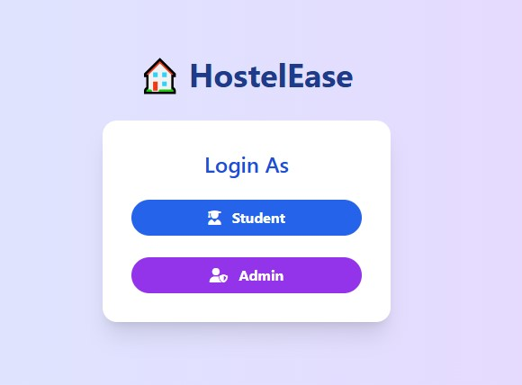
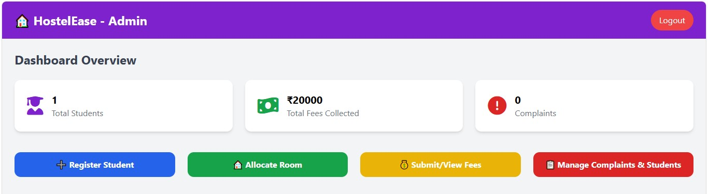
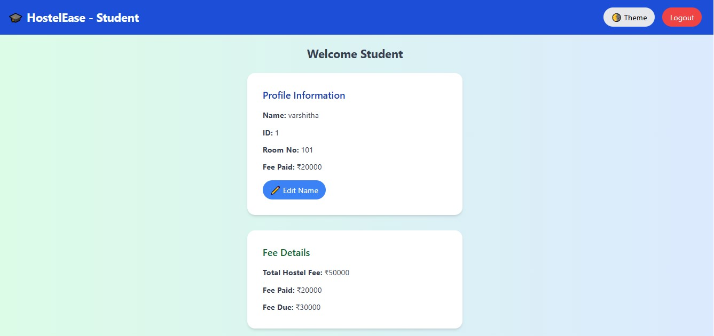
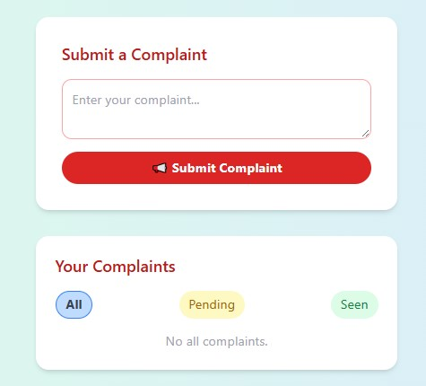

🏨 Online Hostel Management System – HostelEase

📌 Project Overview

**HostelEase** is a web-based Online Hostel Management System developed to simplify and streamline hostel administration. It provides a user-friendly platform for managing student information, room details, hostel fees, complaints, and administrative activities.

The system provides separate interfaces for students and administrators, making hostel-related operations more organized, accessible, and efficient.

🎯 Project Objectives

- Digitize hostel management activities.
- Simplify student information management.
- Organize room allocation and room details.
- Provide convenient access to hostel fee information.
- Enable students to submit complaints.
- Improve communication and administration through a centralized platform.

✨ Key Features

👨‍💼 Admin Module

- Admin Login
- Admin Dashboard
- Student Information Management
- Room Management
- Fee Management
- Complaint Management

🎓 Student Module

- Student Registration
- Student Login
- Student Dashboard
- View Profile Information
- View Room Details
- View Fee Details
- Submit Complaints
- View Complaint Status

🎨 User Interface

- Simple and user-friendly interface.
- Separate dashboards for students and administrators.
- Interactive web pages.
- Theme customization.
- Clean and organized layouts.

🛠️ Technologies Used

| Technology | Purpose |
|---|---|
| HTML5 | Webpage structure |
| CSS3 | Styling and layouts |
| JavaScript | Interactive functionality |
| Tailwind CSS | UI styling |
| Font Awesome | Icons |

📸 Project Screenshots

1. Login Page

The login interface provides separate login options for students and administrators.

2. Admin Dashboard

The administrator interface provides access to hostel management functionalities.

3. Student Dashboard

The student dashboard displays profile information and hostel fee details.

4. Complaints Management

Students can submit complaints and view their complaint status.

📂 Project Structure

Online-Hostel-Management-System/
│
├── screenshots/
│   ├── admin-dashboard.jpg
│   ├── complaints-page.jpg
│   ├── login-page.jpg
│   └── student-dashboard.jpg
│
├── admin-dashboard.html
├── admin-login.html
├── complaints.html
├── fee.html
├── index.html
├── login.html
├── register.html
├── room.html
├── script.js
├── student-dashboard.html
├── student-login.html
├── style.css
├── view.html
│
└── README.md

🚀 How to Run the Project

Follow these steps to run the application locally:

**Step 1: Clone the repository**

git clone https://github.com/Anvitha-28/Online-Hostel-Management-System.git

**Step 2: Open the project**

Open the downloaded project folder in Visual Studio Code.

**Step 3: Install Live Server**

Install the Live Server extension in VS Code if it is not already installed.

**Step 4: Run the application**

Open `index.html`, right-click, and select **Open with Live Server**.

**Step 5: View the application**

The application will open in your default web browser.

🔮 Future Enhancements

- Database integration for persistent data storage.
- Secure authentication and authorization.
- Online hostel fee payment integration.
- Email and notification services.
- Advanced reporting and analytics.
- Improved room availability management.

👩‍💻 Developer

**Anvitha**

GitHub Profile: [Anvitha-28](https://github.com/Anvitha-28)

Project Repository: [Online Hostel Management System](https://github.com/Anvitha-28/Online-Hostel-Management-System)

📄 License

This project is developed for educational and learning purposes.
